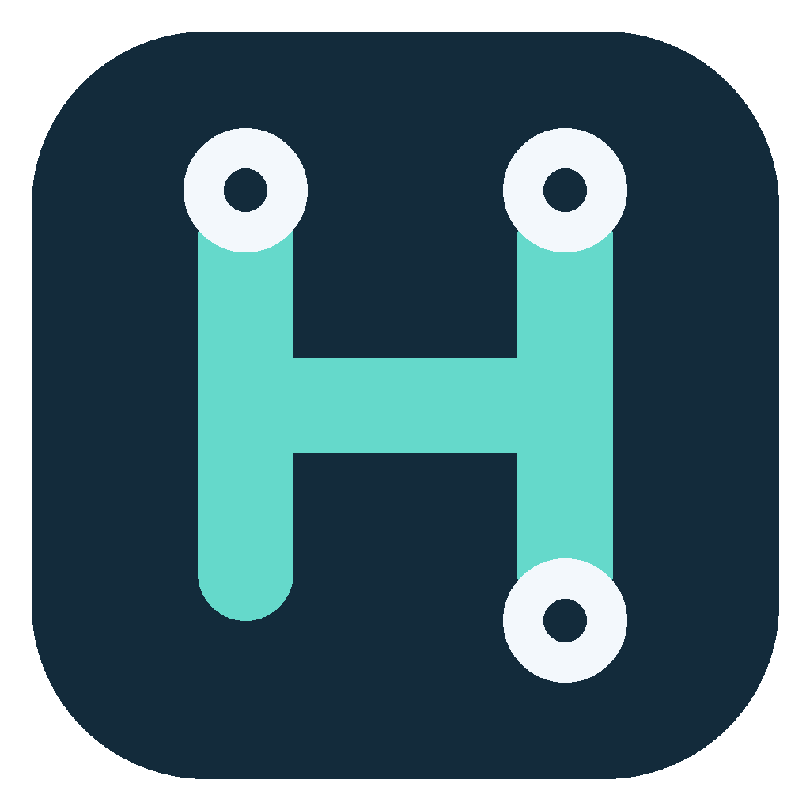

<p align="center"></p>
<h1 align="center">OpenHID</h1>
<p align="center">Native, local-first device management in Rust.</p>

[简体中文](docs/README.zh-CN.md) · [Development](docs/DEVELOPMENT.md) ·
[Usage](docs/USAGE.md) · [Source attribution](docs/PROVENANCE.md)

## Origin and independent maintenance

OpenHID originated from [AprilNEA/OpenLogi](https://github.com/AprilNEA/OpenLogi),
with upstream base
[`abc815acf9ebb4df06ccc574016bad2c9b4152ee`](https://github.com/AprilNEA/OpenLogi/commit/abc815acf9ebb4df06ccc574016bad2c9b4152ee)
and local fork snapshot `11db0bbebe10d761c0830ded6cc9cee39f38e160`.
The standalone Git history begins with one source import, including local fork
changes and the OpenHID rename. Earlier upstream commits remain available in
the original repository. Importing the source does not claim authorship of
inherited code.

It is now maintained independently by [Ben8368](https://github.com/Ben8368)
and OpenHID contributors, with its own development direction, issue tracking,
and future releases. Upstream changes are not synchronized automatically;
future adoption is reviewed individually. Credit remains with the original
authors and contributors. The inherited [MIT](LICENSE-MIT) and
[Apache-2.0](LICENSE-APACHE) licenses are preserved.

See [NOTICE](NOTICE) and [source provenance](docs/PROVENANCE.md) for the import
record, earlier HID++ origin, third-party dependencies, and artwork licensing.

## Current scope

The inherited implementation supports Logitech mice, keyboards, and UVC
cameras on macOS, Linux, and Windows. Features include supported-device button
remapping, DPI, SmartShift, gestures, per-application profiles, battery status,
and camera controls. It also shows low-battery notices and lock-key indicators
for supported devices. Device support depends on the model and connection.

The long-running agent owns HID and input access. The desktop application and
Actions Ring overlay communicate with it over local IPC. Configuration is
stored locally as TOML; no account is required.

The OpenHID name does not mean universal HID compatibility. Other brands,
including AULA F87 PRO, require protocol-specific work and are not added by
this import.

## Build from source

Install stable Rust and the platform prerequisites in
[the development guide](docs/DEVELOPMENT.md). Then run:

```sh
git clone https://github.com/Ben8368/OpenHID.git
cd OpenHID
cargo build -p openhid
cargo run -p openhid -- list
cargo run -p openhid-desktop
```

The GUI needs a running agent for device management. For a source development
session, launch it in another terminal:

```sh
cargo run -p openhid-agent --bin openhid-agent
```

On macOS the desktop dev runner starts its matching agent. For a scripted
inventory without hardware, use `openhid-agent-mock` instead of the real agent.
See the development guide for platform permissions and mock sessions.

OpenHID uses its own configuration and IPC namespace. Existing OpenLogi
settings and OS permissions are not imported automatically.

## Distribution status

This import does not publish an OpenHID installer or enable an update service.
Build from source until releases are published in this repository. Upstream
OpenLogi installers, Homebrew packages, update feeds, signing identities, and
translation services are not OpenHID distributions. Workspace crates are not
published to crates.io by this import.

The OpenHID logo and application icons are original replacement artwork;
upstream proprietary brand assets are not used. Device-image services remain
external sources with their own rights and availability.

## Contributing and licensing

Start with [AGENTS.md](AGENTS.md) and [docs/DEVELOPMENT.md](docs/DEVELOPMENT.md).
Changes should be focused, verified on the affected platforms, and preserve
source attribution. Report issues against this repository.

Source is available under **MIT OR Apache-2.0**, except where a file or component
specifies another license. The HID++ fork retains **0BSD**. See [NOTICE](NOTICE).
OpenHID is not affiliated with or endorsed by AprilNEA, Logitech, or AULA.
